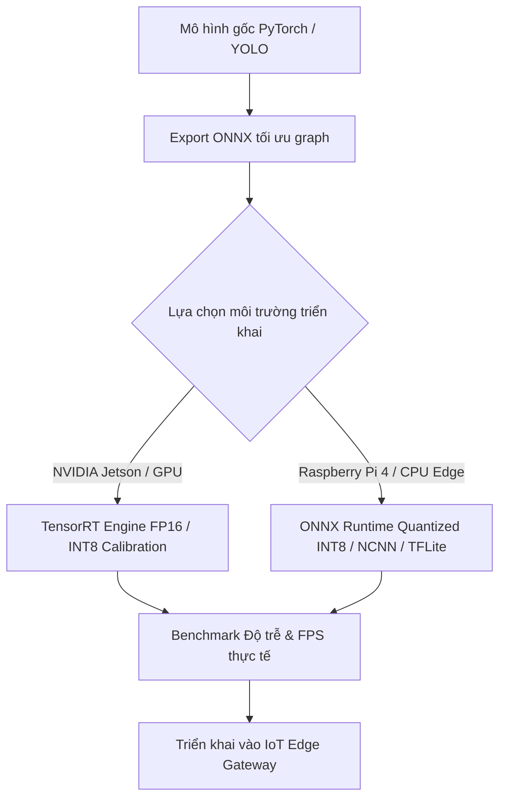

# 🔬 SecurityGate Research & Model Optimization

Thư mục nghiên cứu, thử nghiệm và tối ưu hóa các mô hình Trí Tuệ Nhân Tạo (Computer Vision & Edge AI) phục vụ hệ thống cổng an ninh thông minh **SecurityGate (SEP490)**.

---

## 🎯 Mục Tiêu Nghiên Cứu (Research Objectives)

1. **Nhận diện Biển số Xe Tự động (ALPR - Automatic License Plate Recognition):**
   - Phát hiện phương tiện (Ô tô, Xe máy) và vùng biển số (License Plate Detection).
   - Tách ký tự và nhận diện ký tự quang học (OCR) chuẩn biển số xe Việt Nam (biển vuông 2 dòng, biển dài 1 dòng).
2. **Xác thực Danh tính Người điều khiển (Face Recognition & Anti-Spoofing):**
   - Đối chiếu khuôn mặt tài xế với hồ sơ cư dân / nhân viên đăng ký.
   - Phát hiện gian lận giả mạo khuôn mặt qua ảnh / màn hình điện thoại (Liveness Detection).
3. **Tối ưu hóa Mô hình trên Thiết bị Biên (Edge Computing Optimization):**
   - Mục tiêu triển khai trực tiếp trên thiết bị tính toán biên tại chốt kiểm soát (Raspberry Pi 4, Jetson Nano, Jetson Orin Nano).
   - Độ trễ xử lý (Inference Latency): `< 150ms` / lượt xe.
   - Tốc độ khung hình (Throughput): `>= 20 FPS`.
   - Giảm thiểu tài nguyên phần cứng: CPU `< 60%`, RAM `< 1.2 GB`, hạn chế tỏa nhiệt.

---

## 📂 Cấu Trúc Thư Mục Research

```text
research/
├── README.md                 # Tài liệu tổng quan nghiên cứu (file này)
├── requirements.txt          # Danh sách thư viện Python phục vụ huấn luyện & benchmark
├── models/                   # Kiến trúc mô hình & quản lý trọng số (Weights/Checkpoints)
│   ├── README.md
│   └── .gitkeep
├── optimization/             # Scripts tối ưu hóa (Quantization FP16/INT8, ONNX, TensorRT)
│   ├── README.md
│   ├── export_onnx.py        # Pipeline xuất mô hình sang định dạng ONNX tối ưu
│   └── .gitkeep
├── evaluation/               # Đánh giá độ chính xác, đo đạc Benchmark độ trễ & tài nguyên Edge
│   ├── README.md
│   ├── benchmark_edge.py     # Script đo lường latency, throughput FPS và tiêu hao RAM/CPU
│   └── .gitkeep
├── datasets/                 # Hướng dẫn chuẩn bị và phân chia tập dữ liệu
│   ├── README.md
│   └── .gitkeep
└── notebooks/                # Jupyter Notebooks phục vụ EDA và thử nghiệm thuật toán
    ├── README.md
    └── .gitkeep
```

---

## 🚀 Hướng Dẫn Cài Đặt Môi Trường

Khuyến nghị sử dụng Python 3.10 hoặc 3.11 trong môi trường ảo:

```bash
# Tạo môi trường ảo
python -m venv .venv

# Kích hoạt môi trường ảo
# Trên Windows:
.venv\Scripts\activate
# Trên Linux/macOS:
source .venv/bin/activate

# Cài đặt thư viện
pip install --upgrade pip
pip install -r requirements.txt
```

---

## ⚙️ Quy Trình Tối Ưu Hóa (Optimization Workflow)


