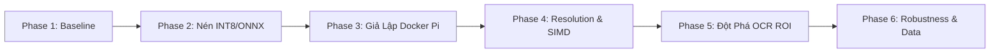

# 🚗 Hệ Thống Nhận Diện Biển Số Xe Việt Nam Tối Ưu Cho Thiết Bị Nhúng (Edge ALPR Pipeline)

Dự án nghiên cứu, hiện thực hóa và tối ưu hóa hệ thống nhận diện biển số xe máy và ô tô tại Việt Nam (**Two-Stage Vietnamese ALPR Pipeline**: Detector + Recognizer), hướng tới triển khai thực tế trên các dòng phần cứng nhúng biên bị giới hạn tài nguyên tính toán (**Edge Devices / ARM** như Raspberry Pi 4/3/2, Jetson Nano).

---

## 📚 1. HỆ THỐNG TÀI LIỆU TIẾN ĐỘ NGHIÊN CỨU (RESEARCH PROGRESS DOCS)

Toàn bộ quá trình nghiên cứu, các thí nghiệm kiểm chứng, lệnh terminal thực thi và kết quả đo đạc định lượng thực tế qua từng giai đoạn đã được chuẩn hóa và lưu trữ tại thư mục **[`doc/`](doc/README.md)**:



### 📑 Chi Tiết Từng Giai Đoạn (Bấm Vào Để Xem):
1. **[Phase 1: Chuẩn Hóa Codebase & Baseline Ban Đầu](doc/phase_1_baseline_and_refactoring.md)**
   - Tái cấu trúc codebase cũ thành thư viện dạng module độc lập (Plug-and-Play).
   - Đo đạc baseline PyTorch gốc (~134ms), phát hiện phụ thuộc nặng >1.5GB và ngốn 331MB RAM.
2. **[Phase 2: Nén Mô Hình (Pruning, Quantization INT8 & ONNX)](doc/phase_2_model_compression_quantization.md)**
   - Chuyển đổi PyTorch ➔ ONNX opset 18, Dynamic Quantization INT8 (`QUInt8`), L1 Pruning 25%.
   - **Kết quả:** Kích thước file **giảm 72.6%** (11.7MB ➔ 3.2MB), **RAM giảm 83.8%** (53MB), bảo toàn **IoU 97.8%** và Conf 92.2%.
3. **[Phase 3: Giả Lập Môi Trường Raspberry Pi & Stress-Test](doc/phase_3_docker_rpi_simulation_stresstest.md)**
   - Đóng gói container Docker Debian Bookworm siêu nhẹ (<350MB, Zero-PyTorch).
   - Stress-test từ Pi 4 xuống Pi 256MB RAM: Sống sót an toàn không bị OOM Kill; phát hiện nút thắt chuyển từ RAM sang **Compute-Bound** (OCR ngốn 5.3s – 34.4s).
4. **[Phase 4: Tinh Chỉnh Resolution Scaling & Threading SIMD](doc/phase_4_resolution_scaling_and_runtime.md)**
   - Export Dynamic ONNX Input, khảo sát độ phân giải (640 ➔ 320) & số luồng CPU (4T, 2T, 1T).
   - **Kết quả:** Điểm ngọt Pareto **`480x480`** (tăng tốc 1.64x – 2.07x), xác định số luồng tối ưu theo nhân phần cứng, tắt angle cls tiết kiệm 1s – 2.3s.
5. **[Phase 5: Đột Phá Tầng OCR (ROI Downscale & Tinh Giản DBNet)](doc/phase_5_ocr_roi_and_preprocessing.md)**
   - Tìm ra lỗi tự động upscale 736 của RapidOCR, chuẩn hóa ROI height $H=96$, tinh giản DBNet no-dilation.
   - **Kết quả:** **OCR tăng tốc 5.85x** (từ 3.32s xuống 0.56s trên Pi 4). Toàn bộ pipeline đạt **~668ms (~1.5 FPS)**!
6. **[Phase 6: Khung Đánh Giá Robustness & Chuẩn Bị Dữ Liệu Kiểm Thử](doc/phase_6_robustness_benchmark_and_data_preparation.md)**
   - Thiết lập chiến lược dữ liệu 2 nguồn (Source A chuẩn hóa sinh nhiễu vs Source B ảnh thật đối chứng).
   - Xây dựng ma trận 4 nhóm nhiễu (Ánh sáng, Mờ, Thời tiết, Hình học), hệ thống chỉ số mAP, EM, CER và phân rã task 5 người.

---

## 🏆 2. BẢNG TỔNG KẾT HIỆU NĂNG TOÀN DIỆN (END-TO-END PIPELINE)

Dưới đây là kết quả đo đạc thực tế sau khi áp dụng toàn bộ các kỹ thuật tối ưu hóa (YOLOv8 INT8 `480x480` + RapidOCR Tối Ưu):

| Thế Hệ Phần Cứng | Giới Hạn Phần Cứng | Pipeline Gốc (FP32 PyTorch 640 + OCR Chậm) | Pipeline Tối Ưu Hiện Tại (INT8 480 + RapidOCR Tối Ưu) | Thời Gian Tiết Kiệm | Tỷ Lệ Tăng Tốc Toàn Diện |
| :--- | :--- | :---: | :---: | :---: | :---: |
| **Raspberry Pi 4** | `4.0 Cores / 2048 MB` | 4,184.24 ms (~0.24 FPS) | **~668.74 ms (~1.50 FPS)** | 🔻 **Nhanh hơn 3.5 giây** | 🚀 **6.26×** |
| **Raspberry Pi 3** | `2.5 Cores / 1024 MB` | 6,597.99 ms (~0.15 FPS) | **~1,154.42 ms (~0.87 FPS)** | 🔻 **Nhanh hơn 5.4 giây** | 🚀 **5.71×** |
| **Raspberry Pi 2** | `1.5 Cores / 512 MB` | 10,856.81 ms (~0.09 FPS) | **~1,900.98 ms (~0.53 FPS)** | 🔻 **Nhanh hơn 8.9 giây** | 🚀 **5.71×** |

---

## 📁 3. Cấu Trúc Mã Nguồn (Directory Structure)

```text
├── doc/                          # 📚 TÀI LIỆU TIẾN ĐỘ NGHIÊN CỨU CHI TIẾT THEO TỪNG PHASE
│   ├── README.md                 # Mục lục và sơ đồ lộ trình nghiên cứu
│   ├── phase_1_baseline_and_refactoring.md
│   ├── phase_2_model_compression_quantization.md
│   ├── phase_3_docker_rpi_simulation_stresstest.md
│   ├── phase_4_resolution_scaling_and_runtime.md
│   └── phase_5_ocr_roi_and_preprocessing.md
├── pipeline/                     # ⚙️ CORE PIPELINE DẠNG MODULE ĐỘC LẬP (PLUG-AND-PLAY)
│   ├── detector.py               # Wrapper YOLOv8 PyTorch (cho máy phát triển)
│   ├── detector_onnx.py          # Pure ONNX YOLO Detector (Zero-PyTorch, hỗ trợ dynamic imgsz)
│   ├── recognizer_rapid.py       # RapidOCR đã tối ưu (ROI H=96, limit=320, no-dilation, no-cls)
│   ├── recognizer_lprnet.py      # LPRNet CTC Recognizer
│   ├── postprocess.py            # Quy chuẩn định dạng biển số xe Việt Nam (1 dòng & 2 dòng)
│   ├── alpr_pipeline.py          # Lớp điều phối tổng thể ALPRPipeline
│   └── optimize.py               # Toolkit tối ưu hóa: Pruning + Quantization INT8 + Export ONNX
├── evaluation/                   # 📊 BỘ SCRIPT BENCHMARK & KIỂM CHỨNG ĐỊNH LƯỢNG
│   ├── benchmark_speed.py        # Đo Latency, Std Dev, FPS
│   ├── verify_comparison.py      # Kiểm chứng IoU đối chứng FP32 vs INT8
│   ├── benchmark_edge_resources.py # Đo mức tiêu hao RAM và CPU
│   ├── benchmark_scaling_hardware.py # Đo Resolution Scaling (640 -> 320) & Thread Scaling
│   └── benchmark_ocr_roi.py      # Đo đạc tối ưu hóa tầng OCR ROI & Preprocessing
├── weights/                      # 🗜️ CÁC PHIÊN BẢN TRỌNG SỐ MÔ HÌNH
│   ├── best.pt                   # PyTorch FP32 gốc (5.97 MB)
│   ├── best.onnx                 # ONNX Dynamic FP32 (11.90 MB)
│   ├── best_int8.onnx            # Dynamic INT8 tối ưu cho Pi (3.20 MB, nén 72.6%)
│   ├── best_pruned.pt            # Trọng số đã cắt tỉa 25% (11.78 MB, 24.91% Sparsity)
│   └── lprnet.pth                # Trọng số LPRNet CTC
├── samples/                      # Ảnh mẫu test nhanh (test1.jpg, test2.jpg, test3.jpg)
├── data/                         # Bộ dữ liệu thực nghiệm (dataset_bienso train/val/test)
├── output/                       # Thư mục lưu kết quả nhận diện, ảnh đối chứng & file JSON
├── Dockerfile.rpi4               # Docker Image ARM64 / Debian Bookworm siêu nhẹ (<350 MB)
├── docker-compose.rpi4.yml       # Cấu hình giới hạn phần cứng mô phỏng Pi 4 (4 Cores, 2GB RAM)
├── requirements_edge.txt         # Dependencies cho Edge (Chỉ cần onnxruntime, opencv, numpy)
├── requirements.txt              # Dependencies đầy đủ cho máy phát triển
└── run_demo.py                   # CLI Runner chính chạy toàn bộ hệ thống
```

---

## 🚀 4. Hướng Dẫn Chạy Nhanh (Quickstart)

### A. Chạy trên máy phát triển:
```bash
# Cài đặt thư viện:
pip install -r requirements.txt

# Chạy nhận diện với mô hình INT8 tối ưu:
python run_demo.py --weights weights/best_int8.onnx --no_show
```

### B. Chạy trong môi trường Raspberry Pi 4 (Docker Container):
```bash
# Build và chạy mô phỏng giới hạn phần cứng 4 Cores, 2GB RAM:
docker compose -f docker-compose.rpi4.yml run --rm alpr-rpi4-simulation
```

### C. Chạy chuỗi benchmark đo đạc định lượng:
```bash
# 1. Benchmark Resolution & Hardware Threads:
docker run --rm --cpus=4.0 --memory=2048m -v "%cd%:/app" data-alpr-rpi4-simulation:latest python evaluation/benchmark_scaling_hardware.py --profile "Raspberry Pi 4" --threads 4

# 2. Benchmark Tối ưu hóa tầng OCR ROI:
docker run --rm --cpus=4.0 --memory=2048m -v "%cd%:/app" data-alpr-rpi4-simulation:latest python evaluation/benchmark_ocr_roi.py --profile "Raspberry Pi 4" --threads 4
```
