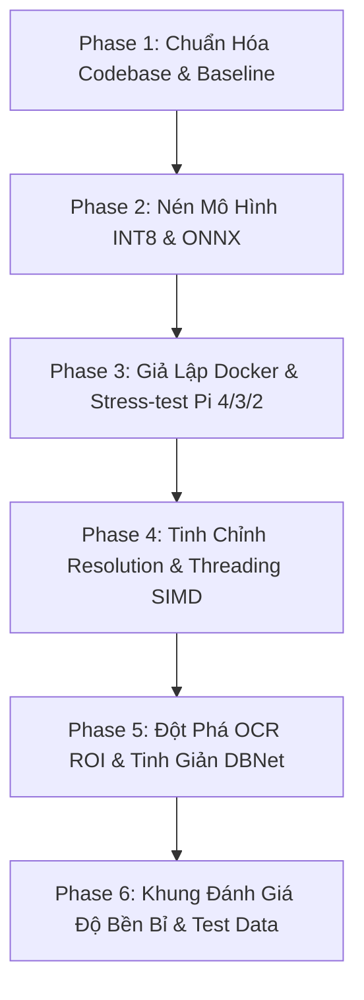

# 📚 HỆ THỐNG TÀI LIỆU TIẾN ĐỘ NGHIÊN CỨU THEO TỪNG GIAI ĐOẠN (ALPR RESEARCH DOCS)

Thư mục này lưu trữ chi tiết tiến độ nghiên cứu, lệnh thực thi và kết quả đo đạc thực tế của hệ thống nhận diện biển số xe Việt Nam tối ưu cho thiết bị nhúng (Raspberry Pi / ARM) được phân chia rõ ràng theo từng giai đoạn (**Phase-by-Phase**).

---

## 🗺️ Lộ Trình Phát Triển & Bản Đồ Tài Liệu



### 📑 Danh Sách Tài Liệu Chi Tiết:

| Tài Liệu | Nội Dung Cốt Lõi | Kết Quả Chính Đạt Được |
| **[Context & Baseline Paper Foundation](context.md)** | Phân tích bài báo nền tảng Paper 23, định vị nghiên cứu, ma trận đối chứng và hướng dẫn trích dẫn khoa học. | Nền tảng lý thuyết & thực nghiệm để chấp bút bài báo khoa học. |
| **[Phase 1: Baseline & Refactoring](phase_1_baseline_and_refactoring.md)** | Tái cấu trúc codebase cũ thành thư viện dạng module Two-Stage độc lập. | Đo đạc độ trễ PyTorch gốc, phụ thuộc nặng ~1.5GB, RAM ~331MB. |
| **[Phase 2: Nén Mô Hình (Pruning & Quantization)](phase_2_model_compression_quantization.md)** | Chuyển đổi PyTorch ➔ ONNX opset 18, Dynamic Quantization INT8, L1 Pruning 25%. | **Giảm 72.6% dung lượng** (11.7MB ➔ 3.2MB), **RAM giảm 83.8%** (53MB), giữ nguyên 92.2% độ tin cậy. |
| **[Phase 3: Giả Lập RPi & Stress-Test](phase_3_docker_rpi_simulation_stresstest.md)** | Tạo container Docker Debian Bookworm siêu nhẹ (<350MB), stress-test từ Pi 4 xuống Pi 256MB RAM. | Sống sót không bị OOM ngay cả ở **256MB RAM**; phát hiện nút thắt chuyển từ RAM sang **Compute-Bound** (OCR chậm). |
| **[Phase 4: Resolution & Runtime Tuning](phase_4_resolution_scaling_and_runtime.md)** | Dynamic ONNX Input, khảo sát độ phân giải (640 ➔ 320) & số luồng CPU (4T, 2T, 1T). | Tìm ra điểm ngọt **`480x480`** (tăng tốc 1.64x – 2.07x), xác định chiến lược thread-pinning cho từng con chip. |
| **[Phase 5: Đột Phá Tầng OCR (Sprint 9)](phase_5_ocr_roi_and_preprocessing.md)** | Mổ xẻ lỗi upscale 736 của RapidOCR, chuẩn hóa ROI $H=96$, tinh giản DBNet no-dilation. | **OCR tăng tốc 5.85x** (từ 3.32s xuống 0.56s trên Pi 4); toàn bộ pipeline đạt **~668ms (1.5 FPS)**! |
| **[Phase 6: Khung Đánh Giá Robustness & Test Data](phase_6_robustness_benchmark_and_data_preparation.md)** | Thiết lập chiến lược dữ liệu 2 nguồn (Source A & B), 4 nhóm sinh nhiễu môi trường xấu, ma trận chỉ số (mAP, EM, CER, Latency) và phân rã task 5 người. | Chuẩn hóa khung kiểm thử độc lập, sẵn sàng chuyển giao thực nghiệm định lượng độ bền bỉ giữa FP32 và INT8. |

---

## 🚀 Hướng Dẫn Chạy Nhanh Toàn Bộ Pipeline Tối Ưu

### Chạy trực tiếp trên máy phát triển:
```bash
python run_demo.py --weights weights/best_int8.onnx --no_show
```

### Chạy mô phỏng trong môi trường Raspberry Pi 4 (Docker Giới hạn 4 nhân, 2GB RAM):
```bash
docker compose -f docker-compose.rpi4.yml run --rm alpr-rpi4-simulation
```
