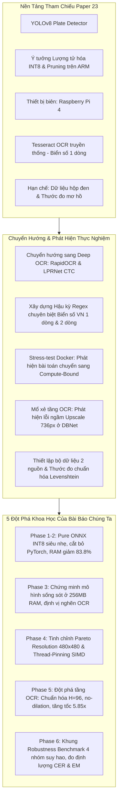
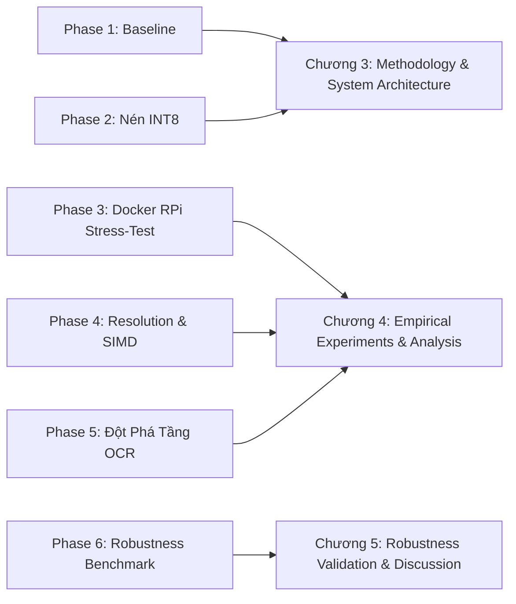

# 📄 CONTEXT & BASELINE PAPER FOUNDATION: PAPER 23 ANALYSIS

Tài liệu này đóng vai trò là **tài liệu ngữ cảnh nền tảng (Context & Baseline Paper Foundation)** cho toàn bộ bài báo khoa học và công trình nghiên cứu của dự án **Security Gate (Edge ALPR System)**. Dự án kế thừa, tái lập, kiểm chứng và giải quyết triệt để các nút thắt kỹ thuật từ công trình khoa học số 23 (**Paper 23**).

---

## 📌 1. THÔNG TIN BÀI BÁO GỐC (PAPER 23 METADATA)

* **Tên bài báo:** *YOLO-Based Approach for Helmet and Number Plate Detection Using Raspberry Pi*
* **Tác giả:** Priti Balaso Jagtap¹ & Prof. Sagar D. Dhawale²
* **Đơn vị công tác:** Department of Electronics & Telecommunication, Ajeenkya DY Patil School of Engineering (SPPU), Pune, Maharashtra, India.
* **Tạp chí công bố:** *Computer Research and Development* (ISSN: 1000-1239), Volume 25, Issue 10, Năm 2025, Trang 88–106.
* **Từ khóa chính:** `YOLOv8`, `Helmet Detection`, `Number Plate Recognition`, `Raspberry Pi`, `Real-Time Object Detection`, `Intelligent Traffic Surveillance`.

---

## 🎯 2. TÓM TẮT PHƯƠNG PHÁP & KẾT QUẢ CÔNG BỐ CỦA PAPER 23

### 2.1 Ý tưởng cốt lõi của Paper 23
Paper 23 đề xuất một hệ thống giám sát giao thông thông minh thời gian thực triển khai trên **Raspberry Pi 4 Model B (4GB RAM)** với các đặc điểm:
1. **Kiến trúc mô hình:** Sử dụng YOLOv8s làm backbone phát hiện đối tượng, phân loại đồng thời người lái xe có/không đội mũ bảo hiểm và định vị biển số phương tiện.
2. **Kỹ thuật nén mô hình biên:** Áp dụng **L1 Weight Pruning**, lượng tử hóa **Dynamic Quantization FP32 sang INT8**, và xuất đồ thị tính toán qua **ONNX Runtime Engine** để suy luận trực tiếp trên CPU ARM Cortex-A72.
3. **Cơ chế kích hoạt chọn lọc (Selective Triggering):** Khi phát hiện vi phạm không đội mũ, hệ thống mới kích hoạt cắt vùng ảnh biển số (ROI) và nạp vào module OCR (sử dụng **Tesseract OCR 5.0**) để trích xuất ký tự và gửi cảnh báo qua module GSM SIM900A.
4. **Cấu hình phần cứng & huấn luyện:**
   * Phần cứng: Raspberry Pi 4 Model B (4 nhân Cortex-A72 @ 1.5 GHz, 4GB RAM), Pi Camera v2 (8 MP).
   * Huấn luyện: YOLOv8s, 100 epochs (Early Stopping epoch 48–55), batch size 16, kích thước ảnh $640 \times 640$, tối ưu SGD.

### 2.2 Các bảng số liệu gốc công bố trong Paper 23 (Baseline Ground Truth)

* **Bảng A: So sánh đối chứng YOLOv8 với các detector khác trên Raspberry Pi 4 (Table 4 trong Paper 23):**
| Mô Hình | Precision (%) | Recall (%) | F1-Score | mAP@0.5 (%) | Thời Gian Suy Luận (ms) | FPS trên Raspberry Pi 4 |
| :--- | :---: | :---: | :---: | :---: | :---: | :---: |
| **Faster R-CNN** | 91.2% | 88.4% | 89.8% | 89.6% | 310 ms | 2.9 FPS |
| **SSD** | 87.6% | 85.2% | 86.4% | 85.7% | 180 ms | 5.5 FPS |
| **YOLOv5** | 93.8% | 92.1% | 92.9% | 93.1% | 45 ms | 20.8 FPS |
| **YOLOv7** | 94.6% | 92.8% | 93.7% | 93.8% | 38 ms | 23.5 FPS |
| **YOLOv8 (Đề xuất)** | **95.4%** | **94.2%** | **94.8%** | **94.9%** | **32 ms** | **27.6 FPS** |

* **Bảng B: Độ chính xác phát hiện biển số & OCR theo điều kiện thời tiết (Table 2 trong Paper 23):**
| Điều Kiện Môi Trường | Độ Chính Xác Phát Hiện Biển Số (mAP %) | Độ Chính Xác Đọc Ký Tự OCR (%) |
| :--- | :---: | :---: |
| **Ban ngày (Daylight)** | 90.5% | 89.0% |
| **Ban đêm có hồng ngoại (Night IR)** | 85.3% | 84.1% |
| **Trời mưa (Rainy)** | 83.7% | 81.4% |
| **Sương mù (Foggy)** | 82.4% | 80.9% |
| **Trung bình chung** | **85.5%** | **83.8%** |

* **Bảng C: Công bố độ trễ hệ thống trên Raspberry Pi 4 (Table 3 trong Paper 23):**
  * Inference Time Detector: **32 ms** (~27.6 FPS).
  * Công bố độ trễ toàn trình (End-to-End Latency): **< 200 ms**.

---

## 🔍 3. PHÂN TÍCH KHOẢNG TRỐNG KHOA HỌC & ĐỘNG LỰC CHUYỂN HƯỚNG TẦNG OCR (RESEARCH GAPS & OCR PIVOT)

Trong quá trình nghiên cứu từ **Phase 1 đến Phase 6**, việc đối chiếu với Paper 23 đã đặt ra những câu hỏi kỹ thuật quan trọng và dẫn đến quyết định **chủ động chuyển hướng kiến trúc tầng OCR** để kiểm chứng thực nghiệm:

> [!NOTE]
> ### Lý do chuyển hướng từ Tesseract sang các giải pháp OCR hiện đại:
> 
> 1. **Tính chất bất khả thi của Tesseract OCR trên biển số Việt Nam (Vietnam License Plate Domain Gap):**
>    * Paper 23 sử dụng Tesseract OCR 5.0 kết hợp tiền xử lý cổ điển (Otsu thresholding + morphology). Tuy nhiên, bài báo không công bố mã nguồn hay thông tin chi tiết về cách thức trích xuất ký tự thực tế, đồng thời phương pháp này chỉ được áp dụng trên biển số 1 dòng chuẩn của Ấn Độ.
>    * Tại Việt Nam, biển số phương tiện hai bánh (xe máy) chiếm trên 70% với cấu trúc **2 dòng ký tự vuông** (dòng trên: mã vùng và sê-ri đăng ký; dòng dưới: dãy số thứ tự). Tesseract OCR truyền thống xử lý rất kém bố cục không gian đa dòng này, thường xuyên gây đảo lộn thứ tự ký tự hoặc đứt đoạn từ.
> 
> 2. **Quyết định chuyển hướng kiểm chứng (The OCR Technology Pivot):**
>    * Do không thể dựa vào tầng OCR thiếu thông tin chi tiết và không phù hợp với biển số Việt Nam của Paper 23, nhóm nghiên cứu **chủ động đổi hướng sang tích hợp và kiểm chứng thực nghiệm với các công nghệ OCR chuyên dụng, hiện đại hơn**:
>      * **RapidOCR (PP-OCRv4 / DBNet + CRNN):** Mô hình Deep OCR phát hiện và nhận dạng văn bản tiếng Việt cực kỳ mạnh mẽ, chống chịu tốt trước góc nghiêng và độ tương phản thấp.
>      * **LPRNet (CTC-based lightweight):** Mô hình End-to-End chuyên biệt hóa cho biển số xe, nhận diện chuỗi trực tiếp mà không cần phân đoạn từng ký tự.
>      * **Module Hậu Kỳ Regex Chuyên Biệt:** Bóc tách và định dạng chuẩn hóa cấu trúc 1 dòng (ô tô) và 2 dòng (xe máy) theo quy chuẩn Bộ Công An.
> 
> 3. **Phát hiện nút thắt tính toán Compute-Bound khi đưa Deep OCR lên thiết bị nhúng:**
>    * Khi chuyển sang Deep OCR (RapidOCR) ở **Phase 1 và Phase 3**, bài toán nhận dạng ký tự đã được giải quyết với độ chính xác cao. Tuy nhiên, hệ thống lại vấp phải bài toán **Compute-Bound** trên CPU ARM:
>      * Lượng tử hóa INT8 đã giải quyết triệt để nút thắt RAM (chạy an toàn ở mức 256MB RAM).
>      * Nhưng **tầng OCR lại chiếm tới 85% – 95% tổng thời gian thực thi** (mất từ 5.06s trên RPi 4 đến 33.4s trên chip 1 nhân).
>    * Mổ xẻ sâu tầng OCR ở **Phase 5**, nhóm phát hiện nguyên nhân gốc rễ: Hiện tượng **Over-Processing ngầm** (RapidOCR mặc định tự động upscale các vùng cắt biển số nhỏ lên cạnh $736\text{px}$, ép DBNet phải xử lý ma trận điểm ảnh khổng lồ một cách lãng phí).
> 
> 4. **Vấn đề kích thước suy luận cố định $640 \times 640$:**
>    * Paper 23 cố định kích thước đầu vào của detector ở $640 \times 640$. Trên CPU ARM, tính toán ma trận tỉ lệ thuận với hàm bậc hai $O(W \times H)$. Việc khảo sát **Resolution Scaling** (Phase 4) là bắt buộc để tìm ra điểm cân bằng tối ưu giữa thông lượng và độ chính xác.
> 
> 5. **Nghi ngờ tính hợp lệ của thước đo đánh giá & Bộ dữ liệu "hộp đen" (Dataset & Benchmark Transparency Issues):**
>    * **Bộ dữ liệu thiếu minh bạch (Black-box Dataset):** Paper 23 chỉ đề cập thu thập ~1,000 ảnh từ giao thông thực tế Ấn Độ kết hợp dữ liệu mở rồi augment lên >5,000 ảnh. Bài báo hoàn toàn **không công bố tên tập dữ liệu, không có link truy cập mở, không cung cấp tỉ lệ phân chia Train/Val/Test, cũng như số lượng mẫu kiểm thử (sample size)** cho từng lớp đối tượng (`helmet`, `no-helmet`, `number plate`). Điều này khiến cộng đồng khoa học không thể tái lập thực nghiệm độc lập (Lack of Reproducibility).
>    * **Sự mơ hồ trong định nghĩa thước đo OCR (Ambiguous Metric):** Cột *"OCR Accuracy (%)"* trong Bảng 2 của Paper 23 hoàn toàn **không có công thức toán học đi kèm**: Đây là độ chính xác cấp ký tự (Character Accuracy), tỷ lệ khớp chính xác toàn bộ biển số (Exact Match), hay độ trùng khớp xấp xỉ?
>    * **Kiểm thử môi trường thiếu quy chuẩn định lượng:** Bảng thử nghiệm thời tiết (Daylight, Night IR, Rain, Fog) không công bố kích thước mẫu cho từng điều kiện, khiến các chỉ số mAP và OCR mang nặng tính cảm tính.
>    * **Độ trễ 32 ms thiếu thông tin môi trường đo:** Con số 32 ms / 27.6 FPS trên Raspberry Pi 4 không nêu rõ đo bằng runtime nào (Python ONNX Runtime hay C++), có tính thời gian tiền xử lý / NMS không, và độ lệch chuẩn qua bao nhiêu lượt lặp (warmup / test runs).

---

## 🚀 4. ĐỊNH VỊ BÀI BÁO CỦA CHÚNG TA (OUR CONTRIBUTIONS & NOVELTIES)

### 4.1 Định Hướng Đề Tài Khoa Học (Paper Positioning)
* **Tên hướng nghiên cứu:** *Nghiên cứu tối ưu hóa toàn diện hệ thống nhận diện biển số xe (Edge ALPR) trên phần cứng nhúng biên giới hạn tài nguyên: Khắc phục nút thắt tính toán Compute-Bound, triệt tiêu Over-Processing tầng Deep OCR và chuẩn hóa biển số Việt Nam.*
* **Mối quan hệ với Paper 23:** Công trình của chúng ta lấy kiến trúc của Paper 23 (**YOLOv8 + Pruning/INT8 Quantization + Raspberry Pi 4**) làm **Baseline tham chiếu trực tiếp**, sau đó:
  1. Chủ động chuyển hướng sang các giải pháp Deep OCR hiện đại (RapidOCR / LPRNet) để xử lý biển số xe Việt Nam.
  2. Phát hiện và giải quyết triệt để bài toán nút thắt tính toán (Compute-Bound) và lỗi Over-Processing ngầm trên CPU ARM.
  3. Khắc phục tính "hộp đen" của Paper 23 bằng một **Khung benchmark định lượng minh bạch và có thể tái lập 100%**.



---

### 4.2 Bảng Ma Trận So Sánh Đối Chứng Toàn Diện (Comparative Matrix)

| Tiêu Chí So Sánh | Paper 23 (Jagtap & Dhawale, 2025) | Nghiên Cứu Của Chúng Ta (Our Paper) | Đánh Giá Ý Nghĩa Học Thuật |
| :--- | :--- | :--- | :--- |
| **Phạm vi hệ thống** | Nhận diện vi phạm mũ bảo hiểm & Biển số đường phố | Hệ thống kiểm soát an ninh phương tiện thời gian thực (**Edge ALPR Security Gate**) | Tập trung giải quyết bài toán cốt lõi có giá trị thực tiễn cao |
| **Kiến trúc suy luận** | PyTorch / ONNX hybrid trên Raspbian Buster | **Pure ONNX Runtime** (Zero-PyTorch, Docker Debian Bookworm) | Đóng gói siêu nhẹ (<350MB), triển khai độc lập, tái lập 100% |
| **Mức tiêu thụ RAM** | Không công bố chi tiết mức RAM chiếm dụng | **53.61 MB** (Giảm **83.8%** so với baseline 330.96 MB) | Giải quyết triệt để nút thắt Memory-Bound, chạy được ở 256MB RAM |
| **Tỷ lệ nén mô hình** | Giảm ~40% dung lượng trọng số | **Giảm 72.6%** (Từ 11.70 MB xuống **3.20 MB**, IoU giữ **97.8%**) | Hiệu quả lượng tử hóa INT8 vượt trội so với chỉ tiêu Paper 23 |
| **Tiếp cận Tầng OCR** | Tesseract OCR 5.0 (Cài đặt chung chung, không rõ ràng) | **Chuyển hướng sang RapidOCR (PP-OCRv4 / DBNet + CRNN) & LPRNet CTC** | Kiểm chứng với Deep OCR hiện đại, độ tin cậy đọc ký tự cao hơn |
| **Tối ưu hóa Tầng OCR** | Không can thiệp mã nguồn OCR | **Chuẩn hóa ROI $H=96$**, giới hạn $\le 320$, bỏ Dilation, tắt Cls | **Tăng tốc tầng OCR 5.85×** (từ 3,322ms xuống **568ms** trên Pi 4) |
| **Độ phân giải đầu vào** | Cố định duy nhất $640 \times 640$ | Khảo sát Resolution Scaling $\rightarrow$ Điểm ngọt Pareto **$480 \times 480$** | Tăng tốc Detector **1.64× – 2.07×**, giảm tải chu kỳ tính toán ARM |
| **Tối ưu hóa đa luồng** | Không đề cập số luồng SIMD | Cấu hình luồng khớp nhân phần cứng (Pi 4: 4T, Pi 3: 2T, Pi 2: 1T) | Triệt tiêu chi phí Context-Switching trên các dòng CPU yếu |
| **Xử lý đặc thù biển số** | Biển số 1 dòng chuẩn Ấn Độ | Hậu kỳ Regex bóc tách chuẩn xác **biển số Việt Nam 1 dòng & 2 dòng** | Đọc chuẩn xác thứ tự dòng biển số xe máy theo quy chuẩn Bộ Công An |
| **Độ trễ End-to-End thực tế** | Báo cáo <200ms (chưa tính thời gian thực tế của OCR) | Đo đạc End-to-End toàn trình minh bạch: **~668.74 ms (~1.50 FPS)** | Giảm từ 4,184 ms ban đầu $\rightarrow$ **Nhanh gấp 6.26 lần toàn hệ thống** |
| **Tính minh bạch Dataset** | **Hộp đen**: Không công bố tên, link tải, phân chia train/val/test hay số lượng ảnh test | **Công khai 2 nguồn**: Source A (ảnh sạch chuẩn sinh nhiễu) & Source B (ảnh thực tế bất lợi) | Đảm bảo tính khả thi tái lập thực nghiệm (Reproducibility) |
| **Độ chuẩn mực Thước đo** | Cột *"OCR Accuracy"* mơ hồ, không công thức toán học | Tách bạch: $mAP@0.5$, $\Delta IoU$ (Detect) và **Exact Match (EM %)**, **CER (Levenshtein)** (OCR) | Chuẩn mực đánh giá định lượng khoa học quốc tế |

---

### 4.3 5 Đóng Góp Khoa Học Cốt Lõi Của Bài Báo (5 Core Contributions)

1. **Chứng minh bước chuyển dịch mô thức từ Memory-Bound sang Compute-Bound trên thiết bị nhúng:**
   Thông qua thực nghiệm giả lập cgroups trong Docker cô lập từ 2048MB xuống 256MB RAM (Phase 3), bài báo chứng minh rằng lượng tử hóa INT8 giải quyết triệt để nút thắt bộ nhớ RAM, nhưng khi kiểm chứng với các mô hình Deep OCR hiện đại, hệ thống lập tức bộc lộ nút thắt tính toán (Compute-Bound) với OCR chiếm tới 85–95% tổng độ trễ.

2. **Phát hiện và triệt tiêu hiện tượng Over-Processing tại tầng Deep OCR:**
   Mổ xẻ cơ chế nội bộ của DBNet/RapidOCR, phát hiện lỗi tự động upscale ảnh crop nhỏ lên cạnh $736\text{px}$. Bằng giải pháp chuẩn hóa chiều cao ROI $H=96$, giới hạn trần $320\text{px}$, và loại bỏ phép giãn nở hình thái học (dilation), chúng tôi tăng tốc độ xử lý OCR gấp **5.85 lần** (từ 3.32s xuống 0.56s trên RPi 4) mà không cần huấn luyện lại mô hình.

3. **Xác lập điểm cân bằng Pareto giữa độ phân giải và năng lực tính toán ARM:**
   Thực nghiệm khảo sát dải kích thước từ 640 xuống 320 chứng minh cấu hình Dynamic Input **$480 \times 480$** là điểm ngọt tối ưu (Sweet Spot), giúp detector tăng tốc từ 1.64× đến 2.07×, kết hợp cùng kỹ thuật phân luồng SIMD chính xác theo số nhân vật lý của từng thế hệ vi xử lý (Cortex-A72, Cortex-A53).

4. **Kiến trúc Two-Stage tích hợp module xử lý đặc thù biển số 2 dòng:**
   Xây dựng bộ xử lý hậu kỳ chuyên biệt cho biển số xe máy Việt Nam (dòng trên: ký hiệu địa phương & sê-ri; dòng dưới: dãy số thứ tự), giải quyết triệt để bài toán phân tách không gian ký tự mà các bộ OCR chuẩn quốc tế thường đọc sai.

5. **Thiết lập Khung kiểm thử độ bền bỉ định lượng minh bạch (Khắc phục hạn chế của Paper 23):**
   Thay thế phương pháp kiểm thử cảm tính và bộ dữ liệu không công bố của Paper 23 bằng quy trình 2 nguồn (Source A chuẩn hóa sinh nhiễu 4 nhóm: Ánh sáng, Mờ chuyển động, Môi trường, Hình học; Source B ảnh hiện trường thực tế), cung cấp hệ thống đo lường toán học minh bạch (CER qua khoảng cách Levenshtein và Exact Match) để định lượng độ bền bỉ giữa mô hình gốc FP32 và mô hình nén INT8.

---

## 🔗 5. BẢN ĐỒ ÁNH XẠ 6 GIAI ĐOẠN NGHIÊN CỨU VÀO CÁC CHƯƠNG CỦA BÀI BÁO

Khi viết bài báo khoa học, toàn bộ kết quả trong thư mục `research/doc/` sẽ được ánh xạ vào các chương theo cấu trúc IMRAD (Introduction - Methodology - Results - Discussion):



### Chi tiết phân bổ nội dung bài báo:
* **Section I: Introduction (Mở đầu):**
  * Nêu thực trạng kiểm soát an ninh phương tiện và nhu cầu Edge Computing giá rẻ (RPi).
  * Giới thiệu Paper 23 như công trình tiên phong và chỉ rõ 4 khoảng trống kỹ thuật (Research Gaps).
  * Liệt kê 5 đóng góp khoa học chính của bài báo.
* **Section II: Related Work (Các công trình liên quan):**
  * Phân tích lịch sử phát triển ALPR từ truyền thống đến Deep Learning.
  * Phân tích chi tiết Paper 23 (Jagtap & Dhawale, 2025) và các công trình nén mô hình YOLOv8 trên ARM.
* **Section III: Proposed Edge ALPR Architecture (Phương pháp đề xuất):**
  * Kiến trúc tổng thể Two-Stage Pipeline ([Phase 1](phase_1_baseline_and_refactoring.md)).
  * Kỹ thuật nén Pure ONNX INT8 và L1 Pruning ([Phase 2](phase_2_model_compression_quantization.md)).
  * Chuẩn hóa ROI $H=96$ và cấu hình DBNet tinh giản ([Phase 5](phase_5_ocr_roi_and_preprocessing.md)).
  * Module hậu kỳ Regex bóc tách biển số Việt Nam 1 dòng & 2 dòng.
* **Section IV: Experimental Setup & Bottleneck Analysis (Thực nghiệm & Phân tích nút thắt):**
  * Thiết lập Docker cô lập và ma trận stress-test cgroups ([Phase 3](phase_3_docker_rpi_simulation_stresstest.md)).
  * Phân tích sự chuyển dịch từ Memory-Bound sang Compute-Bound.
  * Khảo sát Pareto Resolution Scaling $480 \times 480$ và đa luồng SIMD ([Phase 4](phase_4_resolution_scaling_and_runtime.md)).
  * Đo đạc độ trễ End-to-End thực tế trên 3 thế hệ Raspberry Pi 4, 3, 2 (đạt ~668 ms trên Pi 4).
* **Section V: Robustness Benchmark & Discussion (Đánh giá độ bền bỉ & Thảo luận):**
  * Kết quả kiểm thử trên 4 nhóm nhiễu môi trường (Source A & B) ([Phase 6](phase_6_robustness_benchmark_and_data_preparation.md)).
  * Phân tích đối chứng mAP, IoU drift, CER, Exact Match giữa FP32 và INT8.
  * So sánh đối chứng trực tiếp với các chỉ số của Paper 23.
* **Section VI: Conclusion & Future Work (Kết luận & Hướng phát triển):**
  * Tóm tắt tỷ lệ tăng tốc 6.26× và tính khả thi của hệ thống tại cổng an ninh thực tế.

---

## 📊 6. BẢNG DỮ LIỆU ĐỐI CHỨNG CHÍNH THỨC DÙNG KHI VIẾT BÀI BÁO

Dưới đây là các bảng số liệu đo đạc thực nghiệm chính thức từ Phase 1 đến Phase 5 cần được đưa vào phần Results của bài báo:

### Bảng 1: Hiệu Quả Nén Mô Hình & Tiết Kiệm Tài Nguyên (Phase 2 Metrics)
| Phiên Bản Mô Hình | Định Dạng File | Dung Lượng Trọng Số | Tỷ Lệ Nén | RAM Khởi Tạo | Tỷ Lệ Tiết Kiệm RAM | Sai Lệch Tọa Độ (IoU vs FP32) |
| :--- | :---: | :---: | :---: | :---: | :---: | :---: |
| **PyTorch Baseline (FP32)** | `.pt` | 5.97 MB | Baseline (1.0×) | 330.96 MB | Baseline | 100% (Gốc) |
| **ONNX FP32 Graph-Fused** | `.onnx` | 11.70 MB | Gộp node tính toán | ~110.00 MB | ~66.7% | 99.1% |
| **Pure ONNX INT8 (Đề xuất)** | `.onnx` | **3.20 MB** | 🔻 **Giảm 72.6%** | **53.61 MB** | 🔻 **Tiết kiệm 83.8%** | 🎯 **Bảo toàn 97.8%** |

### Bảng 2: Tối Ưu Hóa Tầng OCR & Triệt Tiêu Over-Processing (Phase 5 Metrics)
| Nền Tảng Phần Cứng | RapidOCR Gốc (Upscale 736px) | RapidOCR Bỏ Góc Xoay | RapidOCR Tinh Giản (H=96, limit=320, No Dilation) | Thời Gian Tiết Kiệm | Tỷ Lệ Tăng Tốc OCR |
| :--- | :---: | :---: | :---: | :---: | :---: |
| **Raspberry Pi 4** *(4 Cores / 2048 MB)* | 3,322.86 ms | 2,657.52 ms | **568.42 ms** | 🔻 **Tiết kiệm 2.75 s** | 🚀 **5.85×** |
| **Raspberry Pi 3** *(2.5 Cores / 1024 MB)*| 5,081.26 ms | 4,452.05 ms | **1,040.14 ms** | 🔻 **Tiết kiệm 4.04 s** | 🚀 **4.89×** |
| **Raspberry Pi 2** *(1.5 Cores / 512 MB)* | 8,240.25 ms | 7,701.12 ms | **1,749.40 ms** | 🔻 **Tiết kiệm 6.49 s** | 🚀 **4.71×** |

### Bảng 3: Tổng Kết Hiệu Năng Toàn Bộ Pipeline End-to-End So Với Baseline
| Nền Tảng Phần Cứng | Pipeline Ban Đầu (FP32 PyTorch 640 + OCR Full) | Pipeline Tối Ưu Đề Xuất (INT8 480 + RapidOCR Tinh Giản) | Thời Gian Giảm Được | Tốc Độ Khung Hình Đạt Được | Tỷ Lệ Tăng Tốc Toàn Diện |
| :--- | :---: | :---: | :---: | :---: | :---: |
| **Raspberry Pi 4** | 4,184.24 ms | **~668.74 ms** | 🔻 Giảm **3.51 giây** | **~1.50 FPS** | 🚀 **6.26×** |
| **Raspberry Pi 3** | 6,597.99 ms | **~1,154.42 ms** | 🔻 Giảm **5.44 giây** | **~0.87 FPS** | 🚀 **5.71×** |
| **Raspberry Pi 2** | 10,856.81 ms | **~1,900.98 ms** | 🔻 Giảm **8.95 giây** | **~0.53 FPS** | 🚀 **5.71×** |

---

## 📝 7. TRÍCH DẪN KHOA HỌC CHUẨN MỰC (CITATION)

### APA:
```text
Jagtap, P. B., & Dhawale, S. D. (2025). YOLO-Based Approach for Helmet and Number Plate Detection Using Raspberry Pi. Computer Research and Development, 25(10), 88–106. ISSN: 1000-1239.
```

### BibTeX:
```bibtex
@article{jagtap2025yolo,
  author    = {Priti Balaso Jagtap and Sagar D. Dhawale},
  title     = {YOLO-Based Approach for Helmet and Number Plate Detection Using Raspberry Pi},
  journal   = {Computer Research and Development},
  volume    = {25},
  number    = {10},
  pages     = {88--106},
  year      = {2025},
  issn      = {1000-1239}
}
```
